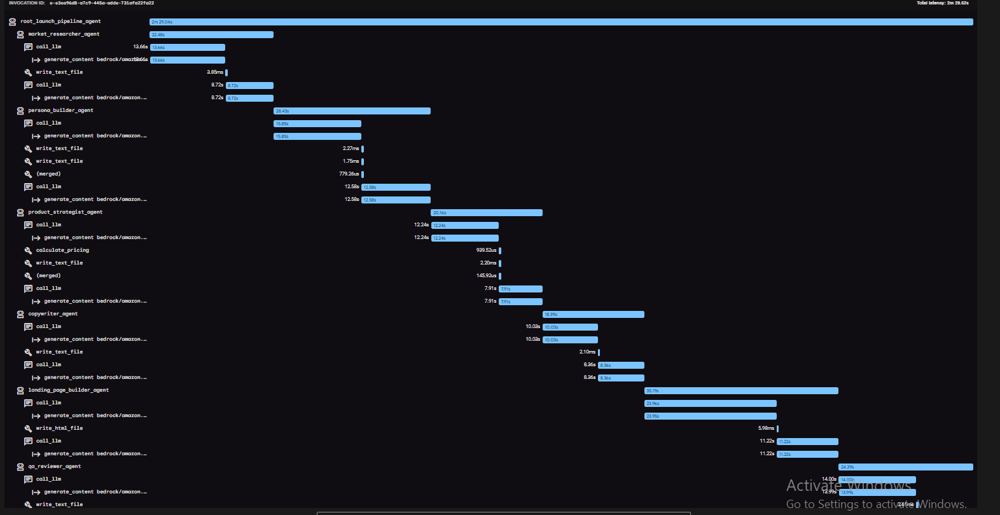

# LaunchPad: 6-Agent Product Launch Kit Pipeline

A Google ADK pipeline that turns a one-line product idea into a complete launch kit: market research, customer personas, product strategy, marketing copy, a responsive landing page, and a QA review.

Six `LlmAgent`s are wrapped in one `SequentialAgent` called `root_agent`. Each agent does one job, saves its final answer to session state through `output_key`, and the next agents read it through `{state_key}` placeholders in their instructions. All agents use `bedrock/amazon.nova-lite-v1:0`.

---

## Pipeline Diagram

```
 User idea
    |
    v
+---------------------------+  output_key: market_research_output
| 1. market_researcher_agent|--> output/<ts>_market_research.md
+-------------+-------------+
              v
+---------------------------+  output_key: personas_output
| 2. persona_builder_agent  |--> output/<ts>_personas.md
+-------------+-------------+
              v
+---------------------------+  output_key: product_strategy_output
| 3. product_strategist_agent|--> output/<ts>_product_strategy.md
+-------------+-------------+      (uses calculate_pricing)
              v
+---------------------------+  output_key: marketing_copy_output
| 4. copywriter_agent       |--> output/<ts>_marketing_copy.md
+-------------+-------------+
              v
+---------------------------+  output_key: landing_page_output
| 5. landing_page_builder_  |--> output/<ts>_landing_page.html
|    agent                  |
+-------------+-------------+
              v
+---------------------------+  output_key: qa_review_output
| 6. qa_reviewer_agent      |--> output/<ts>_qa_review.md
+---------------------------+
```

## Contract Table

| # | Agent `name` | Reads from state | `output_key` | Produces | Tool(s) |
|---|---|---|---|---|---|
| 1 | `market_researcher_agent` | user message | `market_research_output` | Problem statement, target market, 3 competitors with strengths and weaknesses, market gaps, risks | `write_text_file` |
| 2 | `persona_builder_agent` | `{market_research_output}` | `personas_output` | 3 personas: name, age, goals, pain points, buying triggers, quote | `write_text_file` |
| 3 | `product_strategist_agent` | `{market_research_output}`, `{personas_output}` | `product_strategy_output` | Product name, value proposition, MVP features (must-have / nice-to-have), pricing tiers, positioning statement | `calculate_pricing`, `write_text_file` |
| 4 | `copywriter_agent` | `{personas_output}`, `{product_strategy_output}` | `marketing_copy_output` | Tagline, hero headline and sub-headline, 3 feature blurbs, 3 FAQs, CTA, one social post per persona | `write_text_file` |
| 5 | `landing_page_builder_agent` | `{product_strategy_output}`, `{marketing_copy_output}` | `landing_page_output` | One self-contained responsive HTML page using the exact copy | `write_html_file` |
| 6 | `qa_reviewer_agent` | all five earlier outputs | `qa_review_output` | Scores out of 10, cross-agent consistency check, landing page checks, fixes, verdict | `write_text_file` |

## Project Structure

```
starter/
├── agent_runner.py                  # CLI runner (prints events and final state)
├── pyproject.toml
├── .env.example
├── agents/
│   ├── root_launch_pipeline/        # SequentialAgent (root_agent) with the 6 sub-agents
│   ├── market_researcher/           # agent.py, description.txt, instructions.txt
│   ├── persona_builder/
│   ├── product_strategist/
│   ├── copywriter/
│   ├── landing_page_builder/
│   └── qa_reviewer/
├── tools/file_writer_tool.py        # write_text_file, write_html_file, calculate_pricing
├── utils/                           # bedrock_llm.py + file_loader.py
└── output/                          # generated files
```

Every agent folder has the same three files. Prompts live in `instructions.txt` and are loaded with `load_instructions_file(...)`, so no long prompt is hard-coded in Python.

## How the Pipeline Works

1. **State passing.** Each agent has an `output_key`. ADK stores the agent's final text answer in session state under that key. Later agents use `{key}` placeholders in their instructions, and ADK replaces them with the saved text before the model sees the prompt. For example, the copywriter's instructions contain `{personas_output}` and `{product_strategy_output}`.
2. **Instruction structure.** Every `instructions.txt` follows the same sections: ROLE, INPUTS, TASK, OUTPUT FORMAT, RULES, TOOL USAGE. Exact markdown headings in OUTPUT FORMAT keep the small model on template.
3. **Tools.** `write_text_file` and `write_html_file` save timestamped files into `output/`. Agents are told to call the tool once with both arguments and then return the full document as the final answer, because `output_key` stores the final text reply, not the tool arguments.
4. **Custom tool.** `calculate_pricing(cost: float, margin_percent: float) -> dict` computes three price tiers (Basic = cost x (1 + margin / 100), Plus = Basic x 1.4, Premium = Basic x 1.8). The product strategist must call it and copy the returned prices, so prices are calculated instead of invented. The landing page and the QA review then reuse those same numbers.

## How to Run

```bash
cd starter
cp .env.example .env        # add your AWS bearer token and region
uv sync
uv run agent_runner.py      # CLI: enter a product idea, type :q to quit
uv run adk web              # browser UI: pick "root_launch_pipeline"
```

Example idea: `A smart water bottle that tracks hydration for university students.`

Generated files appear in `output/`. A full run takes roughly 2 to 3 minutes.

## Changes to the Starter

With a fresh `uv sync`, the unpinned dependencies installed `google-adk 2.11.0`, `langchain-aws 1.8.1` and Python 3.14. With those versions, agent 1 called `write_text_file` with empty arguments and no file was saved. After my instructor said to use an LLM to fix it, I changed `utils/bedrock_llm.py`:

- **Tool schema.** The wrapper only read `fn.parameters` when describing tools to the model. In ADK 2.x the parameters are in `parameters_json_schema`, so the model was told every tool took no arguments and sent empty calls. The wrapper now reads `parameters_json_schema` first and falls back to `parameters`.
- **Reply parsing.** The wrapper turned the model reply into text with `str(response.content)`. With the newer `langchain-aws`, the content is a list of blocks, so the saved state contained raw text such as `[{'type': 'text', ...}]`. A small helper now extracts only the plain text.
- **Retry.** Nova Lite sometimes produced an invalid tool-use sequence when writing the long HTML page, which raised a `ModelErrorException`. The wrapper now retries that specific error up to 3 times.

Prompt-level fixes made while testing: a "call the tool only once" rule, a rule against code fences and extra sentences around the final answer, and making the tool call the first action for the copywriter and QA agents because they sometimes replied with text and skipped the tool.

## Example Outputs

| Run | Product idea | Folder |
|---|---|---|
| 1 | A smart water bottle that tracks hydration for university students | `output/run1_water_bottle/` |
| 2 | An AI study planner app that turns a student's exam timetable into a daily revision schedule | `output/run2_study_planner/` |

Each folder contains the market research, personas, product strategy, marketing copy, landing page (`.html`) and QA review from one full run.

## adk web Trace



The trace shows all six agents running in order. `calculate_pricing` is called under `product_strategist_agent`, `write_html_file` under `landing_page_builder_agent`, and `write_text_file` under the other agents.

---

## Reflection

**Which agent was hardest to prompt?** The product strategist. It has to call `calculate_pricing` first and then copy the returned prices into a table. Early runs saved a draft with round, invented prices before using the tool, and once a template note I had written in the output format was copied into the document literally. Fixing it meant stating the order of steps explicitly, forbidding saving a draft, and removing bracketed notes from the template. The copywriter and QA agents also sometimes skipped their tool call and just replied with text, so I made the tool call their first action and described skipping it as a failure.

**What did the QA agent catch?** In the final runs the product name, prices, tagline and call to action matched across the strategy, copy and landing page, and the review confirmed it. [WRITE IN YOUR OWN WORDS: describe the one specific inconsistency or defect the QA agent pointed out in your runs and whether it was real.] The QA agent was also unreliable: it sometimes invented prices that were not in any file, listed items as mismatches that matched its own table, and recommended fixes that contradicted its findings. I added rules requiring a fixed four-column table, quoting the exact values, and checking that Plus equals Basic x 1.4 and Premium equals Basic x 1.8. That improved it, but a small model still needs human verification.

**What would I change with other ADK agents?** A `LoopAgent` fits best: put the landing page builder and the QA reviewer inside a loop that repeats until the score is 8 or higher, with the QA feedback passed back through state, and a tool that sets escalate to end the loop. A `ParallelAgent` is only valid where agents are independent. Agents 2 and 3 are not, because the strategist reads the personas, so I would first remove that dependency (or run the personas in parallel with other research) before parallelizing.